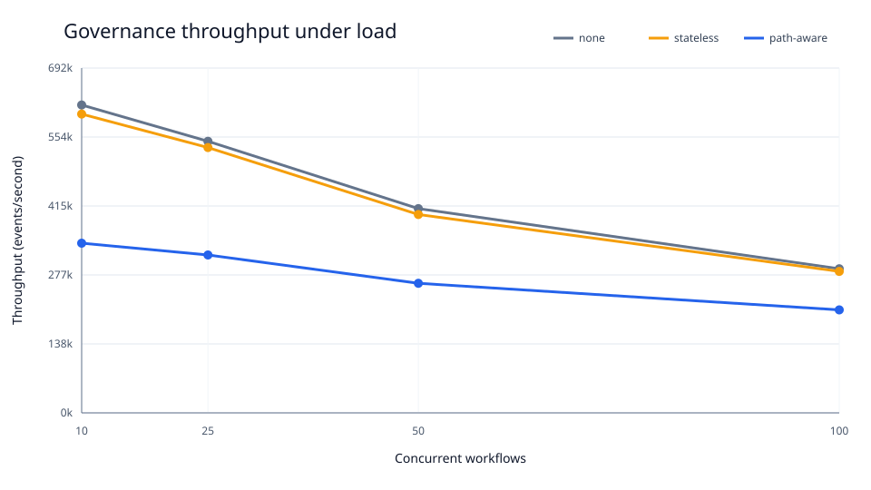
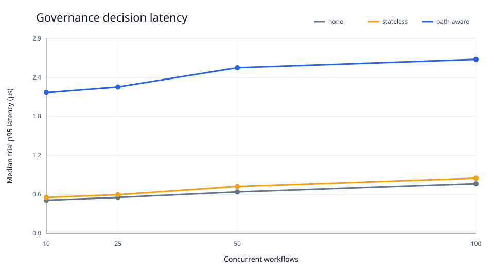
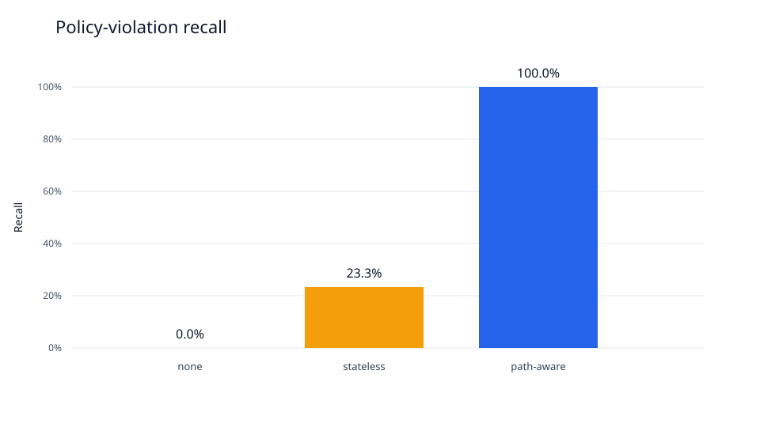

# Benchmark Report

## Executive result

Path-aware governance detected every authored violation with no false positives in the strongly consistent in-process benchmark. Stateless governance detected only the single-action cases, yielding 23.3% recall, while no governance detected none.

Path-aware throughput was 340,497 events/s at concurrency 10 and 206,659 events/s at concurrency 100. Relative to no governance, that is a 44.9% throughput reduction at concurrency 10 and 28.5% reduction at concurrency 100.

## Accuracy

| Mode | Precision | Recall | F1 | False-positive rate |
| --- | ---: | ---: | ---: | ---: |
| none | 0.0% | 0.0% | 0.0% | 0.0% |
| stateless | 100.0% | 23.3% | 37.8% | 0.0% |
| path-aware | 100.0% | 100.0% | 100.0% | 0.0% |

Precision and F1 are shown as zero for no governance because it emits no positive detections; precision is mathematically undefined in that case.

## Consistency sensitivity

The separate controlled state-replication experiment measured a 19.2% stale-read rate and 70.0% recall at 100 concurrent workflows under the fixed weak-replica parameters. Strong state retained 100% recall. These are simulator results and must not be presented as measured Kafka propagation behavior.

## Method

- 3,000 seeded workflows and 7,983 action events per trial.
- Five trials for every mode/concurrency pair.
- Concurrent workflow levels: 10, 25, 50, and 100.
- Identical workflow corpus for every configuration.
- Latency measures only the in-process governance decision; Kafka transport is excluded.
- Throughput includes thread scheduling and all governance calls.
- CPU percentage uses process CPU time divided by wall time; 100% represents one fully utilized core.
- Maximum RSS is a process high-water mark and is not isolated per trial.

## Interpretation and limitations

The results support the core safety hypothesis: history-aware policies catch violations that independent action checks cannot. The measured decision cost remains in microseconds in this prototype, but the Python thread benchmark is CPU/GIL constrained and does not predict distributed production capacity. Kafka transport, persistence, network placement, replication factor, and multi-host state coordination require a separate system benchmark before making deployment claims.

The synthetic labels are generator-authored. The planned two-reviewer blind labeling exercise must still be completed before treating the corpus as frozen ground truth.

## Local Kafka transport check

| Mode | Events | Produce rate | Consume, decide, publish and commit rate | End-to-end rate |
| --- | ---: | ---: | ---: | ---: |
| none | 396 | 370.0 events/s | 130.7 events/s | 96.6 events/s |
| stateless | 396 | 746.4 events/s | 131.5 events/s | 111.8 events/s |
| path-aware | 396 | 752.8 events/s | 121.3 events/s | 104.5 events/s |

This smoke benchmark used the single-node, replication-factor-one local Kafka configuration and synchronous offset commits after every decision. It validates the complete transport path but is not a repeated or multi-host capacity result.
